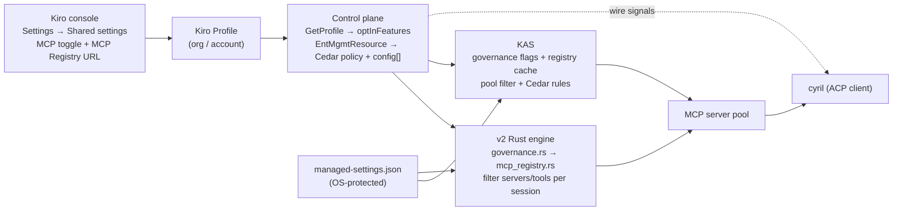

# Kiro enterprise MCP governance — mechanism, wire surface, cyril handling

**Verified 2026-10-16** against **kiro-cli 2.31.1** (KAS `@kiro/agent` 0.66.34). Engines: **v2** Rust (default, `kiro-cli acp`) and **KAS** (`--agent-engine v3|kas`).

**Scope.** How organization/enterprise control of MCP servers works end-to-end: the admin surface, the two client-side enforcement implementations, the wire surface a client sees, and cyril's current handling. Evidence classes: **DOCUMENTED** (kiro.dev prose, fetched 2026-10-16), **STATIC** (2.31.1 binary/bundle literals), **LIVE** (captured frames; this author's non-enterprise account). Lane evidence with full anchors: `experiments/conductor-spike/governance-2.31.1/{public-docs,host-static,kas-static}.md`; cyril inventory §7.

## 1. The documented feature (DOCUMENTED)

| Fact | Exact doc statement | Source |
|---|---|---|
| Default | "By default, your users can use any MCP server in their Kiro client." | [governance/mcp](https://kiro.dev/docs/enterprise/governance/mcp/) |
| Admin surface | "Under **Shared settings**, toggle **Model Context Protocol (MCP)** to **Off**." / "In the **MCP Registry URL** field, choose **Edit**." — controls are attributes of a **Kiro profile** (org level, account-level supersedes) | governance/mcp |
| Who is governed | "MCP governance applies to users authenticating with IAM Identity Center or API keys. Builder ID and social auth users are not subject to organization-level MCP controls." | governance/mcp |
| Tier | "Pro-tier customers using IAM Identity Center can have MCP server access controlled through an MCP registry." | [mcp/registry](https://kiro.dev/docs/mcp/registry/) |
| Enforcement model | "Both the toggle and the registry settings are enforced on the client side. As with any client-enforced configuration, they can be circumvented by users, e.g., via administrative access to their local machine." (warning callout) | governance/mcp |
| MCP off | "All servers (user-configured, legacy, registry, and session-injected) are suppressed and no MCP tools are available to the agent." `/mcp` shows `MCP has been disabled by your administrator`. | governance/mcp; [slash-commands](https://kiro.dev/docs/reference/slash-commands/) |
| Fail closed | "MCP also fails closed if the client cannot reach the governance API: MCP is disabled and `/mcp` shows `Failed to retrieve MCP settings — MCP disabled`." Fail-closed events "are typically transient". | governance/mcp |
| Registry active | Allow-list is the only runnable source: a local `mcp.json` entry "loads only if its name matches an entry in the registry. Anything else is hidden and never started, including servers that were working before the registry was turned on." Delisted servers are terminated and cannot be re-added; version mismatches relaunch at the registry version. | mcp/registry; governance/mcp |
| Registry delivery | Fetched "at startup and every 24 hours" over HTTPS (trusted CA only; self-signed unsupported; may be private to the corporate network). Encrypted in transit and at rest. | governance/mcp |
| Registry format | Subset of the MCP registry standard **v0.1** server schema: `servers[].server` with `name`/`description`/`version` required, at most one of `remotes` (`streamable-http`/`sse`) or `packages` (`registryType` npm/pypi/oci → run via `npx`/`uvx`/`docker`). Version ranges rejected. | governance/mcp |
| User overrides | Registry identity fields are read-only; users may add `env` (local) / `headers` (remote), `timeout`, scope, tool trust. `env`/`headers` merge per-key, user wins. mcp.json marker: `"type": "registry"`. | governance/mcp; mcp/registry |
| Second channel | OS-protected `managed-settings.json` (`/etc/kiro/managed-settings.json`, `C:\ProgramData\Kiro\`, `/Library/Application Support/Kiro/`) carries permission rules — `capability` incl. `mcp`, effect `deny`/`ask` only ("admin rules cannot use `allow`"), precedence "deny > ask > allow". Malformed file ⇒ entire file rejected, "Kiro fails closed". Deployable via Group Policy/SCCM/MDM. | [governance/permissions](https://kiro.dev/docs/enterprise/governance/permissions/) |
| Web exception | "The MCP registry URL and other administrator MCP settings do not apply to Kiro Web sessions." | mcp/registry |

No AppLocker usage is documented anywhere in this story (negative search).

## 2. Enforcement architecture

Three independent channels: **(a)** console profile → governance API → per-engine filter; **(b)** OS-protected `managed-settings.json` (permissions + sign-in controls); **(c)** KAS's Cedar org policy (delivered inside the same management read as the config). A registry allow-list does not require any Cedar rule, and a Cedar `mcp` deny works with the registry off.

**Evidence provenance.** All client-mechanism facts below are STATIC literals in the 2.31.1 artifacts; the mechanism is byte-stable 2.29.1→2.31.1 (host strings A/B) except login-control copy. KAS facts are STATIC from the 0.66.34 carve at `~/.local/share/kiro-research/kas-carves/2.31.1/.../acp-server.js` (byte offsets in `kas-static.md`). LIVE posture from `experiments/conductor-spike/kas-live-sweep-2.31.1.jsonl`.

## 3. v2 / classic implementation (Rust, STATIC)

**Governance fetch** — `chat-cli-v2/src/api_client/governance.rs`: an async *prefetch task* (`governance prefetch task failed, refetching`) resolves three fields (`Retrieved governance config from API: mcp_enabled=…, registry_url=…, web_tools_enabled=…`). Failure is fail-closed: `Failed to get governance config from API: …, defaulting to disabled` → `MCP disabled, web tools disabled` → `user-configured and registry MCP servers are suppressed for this session` and `Dropping session-injected MCP servers: MCP disabled by governance`. Non-enterprise accounts take `Non-enterprise user detected, enabling MCP without registry` (matches LIVE §5). Conversation state persists `mcp_enabled`, `mcp_registry_cache`, `mcp_server_versions`, `mcp_registry_error_type`, `mcp_disabled_due_to_api_failure`.

**Registry** — `chat-cli{,-v2}/src/mcp_registry.rs`. URL sources: governance `registry_url`; the `mcp_registry_url` settings key; and an unnamed test override (`Fetched override registry from …` — trigger not recoverable from strings). Fetch/validate/cache: `Fetching MCP registry from: …`, `Fetched and validated N servers from registry`, `Failed to read response body` / `Failed to parse registry JSON` / `Registry validation failed`, retry `Registry fetch failed, retrying in 1s`, classic cache `Using cached registry data` / `Cache is stale, refreshing` / `Registry URL changed from '…' to '…', invalidating cache`. Per-entry validation templates cover empty name/description/version, missing-or-both `remotes`/`packages`, empty remote URL / package identifier, and enums (`stdio`, `streamable-http`/`sse`, `npm`/`pypi`/`oci`), plus `Duplicate server name found:` and `Registry contains no servers`.

**Filtering** — v2 drops `mcp.json` names absent from the registry (`mcp.json entry dropped: name not in registry`), removes referenced-but-unresolved registry servers (`Removing unresolved registry servers: …`), and logs `BEFORE filtering - Agent …` / `AFTER filtering - Agent …`. Classic filters per agent (`Before registry filtering - agent '…' has … servers:` → `Applied registry filtering to agent '…': … servers validated, … ignored. Agent config preserved with minimal registry entries.`) and filters **tool lists** (`Filtering out tool '…' - server '…' not in registry`). With no registry configured, registry-typed servers are ignored: exact literal `Non-registry mode: ignoring registry-type server '…'` (**not** `on-registry`). Degraded refresh keeps user servers but disables registry servers (`disabling registry servers until next refresh`).

**Corrections to earlier shorthand:** there is **no `accessMode` token and no `mcp/status` method on v2** (0 hits, all bins) — those are KAS/TUI concepts; the v2 wire signal is §5.1.

## 4. KAS implementation (TypeScript bundle, STATIC)

**Origin (two control-plane calls per identity, "management" endpoint).** `GetProfile` → profile body carries `optInFeatures`; `GetEffectiveEnterpriseManagementResourceWithToken` → `{policy (Cedar), configuration[{key,value,source,composeBehavior}]}` with hash-verified manifest. Recognized `configuration` keys: `reference_tracker` and **`mcp_registry_url`** (must start `https://`; overrides the profile URL **only when the profile value is non-empty**); other known keys are ignored with a metric. Reads happen at `initialize` (eager, maxAttempts 2), `session/new`, `session/load`, each `prompt` (identity check), identity change, and an armed **5-minute** enterprise re-read timer.

**Identity classification** (`nme`): `provider ∈ {Enterprise, ExternalIdp}` → governed as organization; `authMethod ∈ {api_key, machine_token}` → ask control plane (eligibility gate); everything else (Builder ID etc.) → **ungoverned** — `isEnterprise:false`, no governance.

**Feature semantics.** Toggle map `FHo(e)=gw(e!=="OFF")` — *absent ≠ OFF ⇒ on* — applies to `mcp` and `webTools`; `GQr(e)=gw(e==="ON")` — *absent ⇒ off* — applies to `autonomousAgents`, `usageAnalytics`, `promptLogging`; `codeReferenceTracker` is on only when `recommendationsWithReferences==="ALLOW"`. `mcpRegistryUrl` is honored only when the MCP toggle is on. Compose: `mcp`/`webTools`/`usageAnalytics` are **ceilings** (lower layers may only turn them off), `autonomousAgents`/`promptLogging`/`codeReferenceTracker`/`mcpRegistryUrl` are **locked**; `_kiro/mcp/toggle` re-reads the effective value after writing, so a user can turn MCP off but never on against an org `off`.

**Disabled reasoning.** `disabledReason` is exactly `"api_failure"` ⇔ enterprise and `lastRead==="failed"` (profile **or** registry-catalog read failure → the all-off value set `UHo`, empty catalog, every server dropped), `"admin_disabled"` ⇔ enterprise and any of the six gated features false, else absent; **`no_endpoint` has 0 occurrences in the 0.66.34 bundle** (the TUI's accepted-value set still lists it; tolerate defensively). Log: `[ProfileSource] organization read failed — fail-closing enterprise governance`. Caveat: failure of the *enterprise-management* read is **not** fail-closed — it degrades to the held profile body (`the profile's decisions stand`).

**Registry, fetched by KAS itself** over `node:https` (UA `Kiro`, 10 s timeout, 2 attempts, ≤2000 servers, ≤10 MiB, in-memory cache 5 min ok / 30 s failure). `accessMode ∈ {registry, nonRegistry}`. Enforcement is a **pool filter**: with a registry URL set, every server whose disposition is not `{status:"registry"}` is filtered out (`accessModeFilteredServers` is a name list), and registry-declared servers missing from the catalog (`unresolvedRegistryServers`) never reach the pool. MCP off ⇒ `resolveRegistry` returns `undefined` ⇒ **zero servers**. In-session, `_kiro/mcp/{toggle,resetServer,getPrompt,getResource}` routes throw when governed off.

**Cedar coexists** — the management body's `policy` document becomes `scope:"organization"` rules; MCP tool calls carry Cedar capability `mcp` (resource `remote/<tool>` or `<power>/<server>/<tool>`), denials surface via `_meta.kiro.policyDenial`; `managed-settings.json` loads as `scope:"administration"` rules (deny/ask only). The registry filter and Cedar are independent mechanisms.

**"KAS enforces governance itself" — confirmed** (upgrading the earlier rollout-note inference): the bundle contains no `managed_settings` / `KIRO_ENABLED_FEATURES` gate (0 occurrences) and the filter/refusal call sites are unconditional. What is rollout-gated is only the *client UI surface* (`/config managed`, governance panel).

## 5. Wire surface (what a client sees)

### 5.1 v2

| Signal | Shape | Notes |
|---|---|---|
| `_kiro.dev/mcp/governance_disabled` | `{ apiFailure: boolean }` | ACP notification, documented since 2.3.0 (agent side wired to emit); `apiFailure:true` = governance API failure path, `false` = admin policy. cyril drops it (§7). |
| `_kiro.dev/webTools/governance_disabled` | same shape assumed | Literal present, but in the 2.31.1 host it occurs only inside a process-health **telemetry** name run (`acp_agent.rs:5987`), not the ACP method inventory — notification-vs-telemetry is an open question. |
| `mcp/status` | — | **Does not exist on v2** (0 hits). v2's nearest are `_kiro.dev/mcp/{startup_status,server_init_failure,server_initialized,oauth_request}`. |

**Name form:** wire methods carry the ACP extension underscore (`_kiro.dev/…` — live-verified on the sibling `_kiro.dev/mcp/server_initialized` in `logs/v2-surface-2.10.0-ab-*.jsonl`). cyril's mediator strips it before conversion (`domain_mediator/mod.rs:751`), so cyril's matchers are spelled `kiro.dev/…`; the 2.31.1 TUI catalog likewise lists `kiro.dev/mcp/governance_disabled`.

Test hook: `KIRO_TEST_GOVERNANCE_DISABLED` forces the disabled path (v2 session manager).

### 5.2 KAS

| Signal | Shape | When |
|---|---|---|
| `_kiro/governance/state` | `{sessionId, isEnterprise, features{mcpEnabled, webToolsEnabled, usageAnalytics, contentCollection, promptLogging, codeReferenceTracker, autonomousAgents}, disabledReason?}` | Unsolicited at session start — LIVE: one frame per session at `session/new` (stdio; the session-less `sessionId:""` form from the 2.14.1 audit is the WS/cloud path, dormant on stdio). |
| `_kiro/mcp/governance_disabled` | `{reason}` (TUI maps `api_failure`/`no_endpoint` → `apiFailure:true`, `admin_disabled` → false) | Session start, MCP disabled only. |
| `_kiro/mcp/status` | `{sessionId, servers[], registryServers?, accessMode?, accessModeFilteredServers?, unresolvedRegistryServers?}` | Session start; registry fields only when a registry URL is configured. LIVE (no registry): `{servers: []}`, no `accessMode`. |
| `_kiro/policy/{changed,error}` | push | Policy state changes. |
| `_kiro/config/template` | `{modes, configOptions}` | Pre-session mode seed (dark `managed_settings` rollout). |
| Callable | `_kiro/policy/check`, `_kiro/permissions/{list,explain}`, `_kiro/mcp/{toggle,resetServer,getPrompt,getResource}` | Read-only check/explain verified live in the 2.7.1 audit. |

**LIVE non-enterprise posture** (`kas-live-sweep-2.31.1.jsonl`, 3 sessions): `isEnterprise:false`, `features{mcpEnabled:true, webToolsEnabled:true, usageAnalytics:false, contentCollection:true, promptLogging:false, codeReferenceTracker:false, autonomousAgents:true}`, no `disabledReason`; `mcp/status` = `{servers: []}`. Matches the v2 non-enterprise path (MCP enabled, no registry).

## 6. `managed-settings.json`

Read by `chat-cli-v2/src/auth/login_controls.rs` (shared with classic) and by KAS. **Login controls** (recovered keys): `idc_region`, `signin_method` (rules with `match`/`exclude`/`effect:"deny"`), `issuer_url` (https-only), `sso_region` — with input hardening (`managed setting contains control characters`, length cap), per-rule drop semantics, and lockout guards (`managed settings denied every sign-in method, ignoring the restriction`). User copy: `This sign-in method is not permitted by your administrator.` **Permission rules** (per the public docs, same file): `capability` incl. `mcp`, effect `deny`/`ask`, `deny > ask > allow`; malformed JSON fails closed. Documented applicability: IDE ≥ 1.2, CLI ≥ 2.25.0.

## 7. cyril handling today (2026-10-16)

| Signal | Handling | Anchor / issue |
|---|---|---|
| v2 `_kiro.dev/mcp/governance_disabled`, `…/webTools/governance_disabled` | **DROPPED** — no arm; falls to the shared catch-all, `debug!`-only | `convert/kiro.rs:1284`; cyril-bmek |
| KAS `_kiro/governance/state` | **DROPPED** | `convert/kiro.rs:1284`; cyril-0o7e, umbrella cyril-58uv |
| KAS `_kiro/mcp/status` (incl. `accessMode`, `accessModeFilteredServers`) | **DROPPED** | same; cyril-nk4o |
| KAS `_kiro/mcp/*` management ops + `mcp/elicitation` | **absent** (not in inbound census) | cyril-nk4o |
| KAS `_kiro/policy/{changed,error}` | **DROPPED** | only ROADMAP row; **no issue** |
| KAS `_kiro/config/template` | **absent** | **no issue** |
| `disabledReason` values / registry access modes | not modeled | **no issue** |
| `_kiro/account/getUsage` `isEnterprise` | **HANDLED** → enterprise badge | `convert/kas.rs:138` |
| v2 `_kiro.dev/mcp/{server_init_failure,server_initialized,oauth_request}` | **HANDLED** | `convert/kiro.rs:1103-1157` |
| Permission/trust enforcement | **HANDLED** (approval overlay + persisted grants) | `convert/mod.rs:286-311` |

Cyril's own outbound behavior is unaffected by governance (it never injects `mcpServers`), so today's impact is **observability only**: a governed user sees MCP servers silently absent. Since KAS enforces server-side-of-the-client, cyril cannot weaken it; it can surface posture (`features`, `disabledReason`, `accessMode`, hidden/unresolved lists) and avoid claiming a capability the org disabled.

## 8. Divergences and open questions

- **Registry refresh cadence:** docs say "at startup and every 24 hours"; KAS uses a 5-min in-memory cache refreshed by governance reads (no 24 h timer in 0.66.34), and v2 fetches per session/agent. Treat the 24 h figure as the user-facing sync promise, not the client mechanism.
- **Registry-fetch failure semantics** (governance OK, registry URL unreachable/malformed): docs only define fail-closed for the governance API; v2 degrades by disabling registry servers (`until next refresh`). Untested.
- **Toggle vs registry precedence**, name-match case rules, session-injected servers under an active registry: undocumented; see `public-docs.md` open questions 1–4.
- **Override-registry trigger** (`Fetched override registry from …`): no env/file name recoverable (host-static L3).
- **Governance API endpoint/auth** (host-side): not recoverable from strings (host-static L1); KAS side is documented in §4.
- **`no_endpoint`**: accepted by the TUI's validator, never emitted by KAS 0.66.34 — clients should tolerate, not expect.
- Further live probes: `host-static.md` L1–L9, `kas-static.md` §9, `public-docs.md` §3.

## Sources

- `experiments/conductor-spike/governance-2.31.1/public-docs.md` — kiro.dev pages (`.md` twins), fetched 2026-10-16.
- `experiments/conductor-spike/governance-2.31.1/host-static.md` — 2.31.1 strings, anchored literals + offsets; A/B 2.29.1.
- `experiments/conductor-spike/governance-2.31.1/kas-static.md` — `acp-server.js` 0.66.34 byte-offset index.
- LIVE: `experiments/conductor-spike/kas-live-sweep-2.31.1.jsonl`, `kas-handshake-cyril-vs-tui-2.31.1.jsonl`; prior captures cited in the audit dirs.
- Prior repo docs: `docs/kiro-2.3.0-wire-audit.md` (notification origin), `docs/kiro-kas-acp-covenant.md` §9, `docs/kiro-2.31.1-wire-audit.md`, `experiments/conductor-spike/audit-2.31.1/{tui-findings.md,host-findings.md,kas-findings.md}`.
