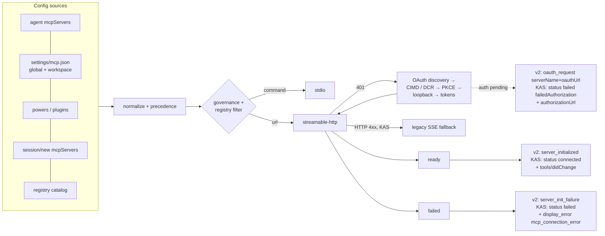

# Remote MCP servers — config processing, OAuth, and the ACP surface (2.31.1)

**Verified:** 2026-10-16 · **Kiro CLI:** 2.31.1 (`kiro-cli-chat`, 216,000,680 B) · **KAS:** `@kiro/agent` 0.66.34 (`acp-server.js` sha256 `9a75422c…0ccfb`) · **TUI:** `kiro-tui-2.31.1.js`

**Scope.** How a **remote** (`url`-bearing) MCP server declaration is processed end-to-end by both engines — config intake → filter → transport → OAuth → ready/failed → tools — and what an ACP client sees. This is the **data path**; org/enterprise controls are in [`kiro-enterprise-mcp-governance.md`](kiro-enterprise-mcp-governance.md). Local (stdio) servers are covered only where they share a pipeline stage.

**Evidence lanes** (literals, anchors, open questions):
- `experiments/conductor-spike/mcp-remote-2.31.1/host-static.md` — v2 Rust engine (`chat-cli-v2` + `agent` crate, `rmcp` 3.0.0).
- `experiments/conductor-spike/mcp-remote-2.31.1/kas-static.md` — KAS (`@kiro/agent` 0.66.34, byte offsets).
- Prior audits consolidated, not re-derived: 2.10.0 (hot-reload live), 2.11.0 (`/mcp auth|cancel-auth|logout`, `^A/^X/^R`), 2.12.0 (`client_secret`, DCR-skip, loopback redirect), 2.12.3 (discovery UA), 2.22.0-deserialization §6 (KAS status), 2.29.1 (issuer fix + `oauthUrl` surfacing), covenant §9 (`_kiro/mcp/*`).

**Anchor convention.** Host-lane offsets are mixed-space (see its erratum); cite literals, not numbers. KAS/TUI offsets are byte offsets into the named bundle.

---

## 1. Pipeline at a glance



Engines differ in where state lives: **v2** hands every remote server to the shared `chat-cli` MCP client and reports per-server notifications; **KAS** owns a config-manager + server pool and pushes one `_kiro/mcp/status` snapshot per session that carries the whole per-server union.

---

## 2. Config intake and precedence

### 2.1 v2 (Rust engine)

| Source | Literals / evidence |
|---|---|
| Agent config `mcpServers` (+ `includeMcpJson` gate) | `Agent`/`AgentConfigV2025_08_22` fields; `Skipping unrecognized MCP server config entry`; v3-shaped agent files refused: `uses the v3 format. Start chat --agent-engine v3` |
| Legacy `mcp.json` — global + workspace `settings/mcp.json` | `failed to load global mcp configs` / `… workspace …`; ` is already configured in agent config. Skipping duplicate from legacy mcp.json.`; `Malformed legacy global mcp config detected` |
| ACP session-injected (`session/new.mcpServers`) | **wins**: `ACP MCP servers override existing servers in agent config`; dropped under governance: `Dropping session-injected MCP servers: MCP disabled by governance` |
| Registry | allow-list **filter**, not a merge: `mcp.json entry dropped: name not in registry`, `Non-registry mode: ignoring registry-type server` |
| Source enum (telemetry, verbatim) | `[registry, global, workspace, agent, acp_injected, unknown]` (`mcp_server_source`) |

- Remote entry shape: `McpServerConfig` is an **untagged** enum — `LocalMcpServerConfig` (6 fields) | `RemoteMcpServerConfig` (8 fields; `forceAuth` known) | `RegistryMcpServerConfig` — i.e. discriminated structurally, not by a `type` tag (`data did not match any variant of untagged enum McpServerConfig`). Forced auth guard: `' is not a remote (HTTP) server; forced auth is only supported for remote servers`.
- Registry `remotes[]`: `transport` ∈ `streamable-http` | `sse`, `serverHttpHeader`; `remotes`/`packages` mutually exclusive (` cannot have both 'remotes' and 'packages' defined`).
- **Unknown:** whether v2 parses the documented `"type":"registry"` marker (0 literal hits); global-vs-workspace `mcp.json` precedence; `session/new.mcpServers` entry schema on v2 (lane §8 Q1/Q2/Q8).

### 2.2 KAS (TypeScript engine)

One declaration schema for every non-client source — `mcp.json`, agent front matter, powers, plugins:

```js
{ env: Record<string,string>, timeout: number, waitForReady: bool, disabledTools: string[],
  autoApprove: string[], versionNegotiation: "auto"|"legacy",
  command?: string, args?: string[], cwd?: string,            // stdio
  url?: string, headers?: Record<string,string>,              // remote
  oauth?: { clientId?, redirectUri?, clientMetadataUrl? }, oauthScopes?: string[],
  disabled?: bool, type?: string }                            // type:"registry" special-cased
```

| Property | Evidence (lane §2) |
|---|---|
| Transport = `command` xor `url` — **no `sse` type** for main declarations | `Khr` |
| URL must parse; **https**, or http only for loopback (`localhost`, `127.0.0.1`, or `::1`) | `Yhr`, `Llt` |
| `oauth.clientMetadataUrl` requires https + non-root path (checked only when `clientId` unset); `oauth.redirectUri` http + loopback host, port 1-65535, default path `/oauth/callback` | `Uhr`, `Whr` |
| `${NAME}` substitution recursive; a process-env value whose `.trim()` starts with `()` stays literal; unknown names left as `${NAME}`; `env` = subs(`globalEnvVars`) ∪ subs(declaration `env`) | `zne`, `Hba` |
| Sources | user `<configDir>/settings/mcp.json` (JSONC) + workspace `.kiro/settings/mcp.json` (**only when workspace trusted**); `powers.mcpServers` legacy section; plugin `<power>/mcp.json` (strict: exact fields, entry types `stdio`, `streamable-http`, `sse`, unknown field drops the entry); agent profile front matter; builtin modes (sandbox = `http://127.0.0.1:8080/mcp`); client injection; registry |
| Client-injected (`session/new`, `session/load`, `set_config_option`) | accepts `command/args/env` or `url/headers` + `_meta.kiro.{disabledTools,waitForReady,versionNegotiation}`; **rejects** `timeout`, `autoApprove`, `oauth`, `oauthScopes`, `disabled`, `cwd`; `type:"acp"` skipped (`mcp.client.transport.unsupported`) |
| Precedence | `client ≻ builtin ≻ profile ≻ file (mcp.json)`; file servers additionally gated by the agent's MCP policy (`includeMcpJson`/`allowedTools`/`excludedTools`, `ASBX_KIRO_MANDATORY_MCPS`) |

- **Workspace-trust gate, as shipped:** `readWorkspaceFiles` returns an empty map unless the manager's `workspaceTrusted` is set — but both of this build's agent entrypoints construct it with `workspaceTrusted: !0`, so CLI-spawned KAS reads `<workspace>/.kiro/settings/mcp.json` unconditionally; the gate is live for other embeddings (lane §2.1 addendum).

### 2.3 Filtering

- **Governance** (both engines, fail-closed) — see governance doc. v2: `user-configured and registry MCP servers are suppressed for this session`; KAS: `governed.mcpDisabled` → `_kiro/mcp/governance_disabled`.
- **Registry mode (KAS)** — `accessMode = registry | nonRegistry` (from the org `mcpRegistryUrl`); in `registry`, all non-registry declarations are filtered out and vice-versa (`mcp.registry.resolve.accessModeFiltered`), disabled entries → `disabled`, missing → `unresolvedServers`. Catalog fetch: https only, 10 s timeout, 2 attempts, 2000-server / 10 MiB caps, UA `Kiro`, 300 s cache (30 s negative).

---

## 3. Transport

| Aspect | v2 | KAS |
|---|---|---|
| Streamable HTTP | `StreamableHttpClientWorker<reqwest::Client>`, wrapped in `AuthClient` when OAuth applies (rmcp 3.0.0) | `_Le` class — `mcp-session-id` capture, `text/event-stream` vs `application/json` dispatch, 202 → drain + SSE open, DELETE teardown (405 tolerated), `resumeStream` via `last-event-id`, reconnect 1 s → ×1.5 → 30 s (maxRetries 2) |
| stdio | `TokioChildProcess` | stdio transport |
| SSE | rmcp `client_side_sse` | `Olt` EventSource; reached as **fallback when streamable-HTTP returns 4xx**; also available to plugin `type:"sse"` entries |
| Auth retry | `AuthClient` re-auth + one retry | 401 → parse `www-authenticate` (`resource_metadata`, `scope`) → `onUnauthorized` → one retry; 403 `insufficient_scope` → single step-up re-authorize |
| Era negotiation | n/a | `versionNegotiation: auto\|legacy`; `auto` probes `server/discover`; `-32022` = corrective retry; `{-32001,-32020,-32021}` = legacy; unanswered probe (timeout / era error) → downgrade + `mcp.era.downgraded_after_unanswered_probe` |
| Timeouts | per-server `timeoutMs`; `--require-mcp-startup` (exit 3); `KIRO_REQUIRE_MCP_STARTUP_TIMEOUT_SECS` | connect timeout default 60 s, clamped to 600 s; per-server `timeout`; sub-5 s values flagged `timeout_too_low`; pool concurrency 4 |
| Readiness | n/a (`waitForReady` absent from v2 strings) | `waitForReady` servers gate the first turn via `awaitRequiredMcpServers` → `McpServersNotReadyError` (-32000, "Required MCP server(s) … did not become ready in time") |
| Error taxonomy | rmcp errors surfaced into `server_init_failure.error` | structured SDK codes (`NOT_CONNECTED`, `CONNECTION_CLOSED`, `REQUEST_TIMEOUT`, `CLIENT_HTTP_*`, …) + KAS regex classification; session loss on tool call → reset + retry (`attemptSessionRecovery`) |

---

## 4. OAuth lifecycle

Both engines run the **client-side** OAuth dance themselves (authorization-code + PKCE); the difference is persistence and how a sign-in URL reaches the user.

| Step | v2 | KAS |
|---|---|---|
| Discovery | `oauth-protected-resource`, `/.well-known/oauth-authorization-server`, openid-configuration; root fallback; `issuer` required and validated (`issuer mismatch`, `Authorization server issuer mismatch: expected , received`) | 401 `resource_metadata` → PRM (`MCP-Protocol-Version` header, path-aware well-known, root retry, 404 → "does not implement OAuth 2.0 Protected Resource Metadata"); AS metadata candidates `oauth-authorization-server<path>` → `openid-configuration<path>` → `<path>/.well-known/openid-configuration`; issuer validated unless skipped |
| Registration | DCR (correct `client_name` since 2.12.0); custom `client_id` skips DCR; `clientSecret` supported; **CIMD** when AS advertises `client_id_metadata_document_supported` (downgrade to DCR otherwise; suppressed when `clientSecret` set) | DCR; **CIMD** when flag + `oauth.clientMetadataUrl` (no registration request); pre-registered `oauth.clientId`; DCR refusal on `offline_access` retried once with `refresh_token` grant withheld; friendly DCR refusal message tells the user to ask the admin or set `oauth.clientId` |
| PKCE | `S256`, `code_challenge(_method)` | `S256` required; `state`, `resource` (from PRM), `prompt=consent` for `offline_access` |
| Redirect | loopback only — `host must be 127.0.0.1 or localhost`, http, custom path/port supported (2.12.0) | loopback server on `localhost`, path `/oauth/callback`, ephemeral port unless `oauth.redirectUri` pins it; success/error HTML pages |
| Persistence | `.token.json` / `.registration.json` / `.metadata.json` per server + `secrets.json`; refresh-failure message `… Token refresh failed. Please re-authenticate using /mcp.` | **`secretStorage`** (client callback): keys `kiro.mcp.<sha256(url\|sorted-header-kv[\|cimd:<url>])>.{client,tokens,verifier,discovery}`; credential JSON shapes documented in lane §4.6; SEP-2352 issuer stamp binds the callback leg; no capability → **memory-only** (re-auth every restart) — supersedes the older "KAS keeps its own backend" note |
| User-initiated | `/mcp auth\|cancel-auth\|logout <server>`; TUI `^A/^X/^R`; `oauth_request {serverName, oauthUrl}` frame | `_kiro/mcp/resetServer {serverName, startOAuth:true}` → `explicit-reauth` phase; lazy mid-session 401 waits up to 5 min for the callback, then retries the tool call |
| Sign-in URL surfacing | ACP `kiro.dev/mcp/oauth_request` — the engine's only auth notification | `_kiro/openExternalUrl` (only `lazy`/`explicit-reauth`; `passive` never opens); **without the capability** the URL is still in `_kiro/mcp/status.servers[].authorizationUrl` and the `display_error{mcp_connection_error}` text says to check the MCP panel |

---

## 5. Status and notification surface

### v2 — `kiro.dev/mcp/*` (all per-server unless noted)

| Method | Payload / when |
|---|---|
| `kiro.dev/mcp/startup_status` | **aggregate**; `McpStartupStatus` = `allStarted \| pending \| determinable`; payload fields unknown (lane §8 Q6) |
| `kiro.dev/mcp/oauth_request` | `{serverName, oauthUrl}` — auth needed (URL added in 2.29.0) |
| `kiro.dev/mcp/server_initialized` | server ready; re-emitted after hot reload |
| `kiro.dev/mcp/server_init_failure` | `{serverName, error}` — auth or transport failure, also on hot-reload of a changed server (2.10.0 LIVE) |
| `kiro.dev/mcp/governance_disabled` | `{apiFailure}` — governance off/fail-closed |

`oauth_cleared` does not exist on the wire (0 hits); the TUI's `mcp_oauth_cleared` is a **reducer event**, emitted internally when a pending server settles non-connected. Tool discovery is not a dedicated frame: the tool list reaches the client via `commands/available` re-advertise (`MCP server tool list changed, re-advertising`).

### KAS — `_kiro/mcp/*`

| Method | Shape / when |
|---|---|
| `_kiro/mcp/status` (notification) | pushed on every pool status change, `session/new`, governance apply, `session/load`, toggle off. `servers[]` union: `connecting {name,authType?,origin,item}`; `connected {…, tools[{name,description,disabled,inputSchema}], prompts, resources, resourceTemplates}`; `failed {…, failedAuthorization, authorizationUrl?, errorMessage, errorCode?}`; `disabled`. Registry mode adds `accessMode`, `accessModeFilteredServers`, `unresolvedRegistryServers`, `registryServers[{name,version,description,enabled}]`. `_meta.kiro.resource` tags each entry |
| `_kiro/mcp/resetServer` | `{serverName, startOAuth?}` → reconnect (≤60 s response ceiling, then `{success:true}` + background) |
| `_kiro/mcp/{getPrompt,getResource}` | prompt/resource reads from the pool |
| `_kiro/mcp/toggle` | enable/disable → empty status push on disable |
| `_kiro/mcp/elicitation` (request) | form/URL elicitation from an MCP server to the client; unresolved → `decline` |
| `_kiro/mcp/governance_disabled` | instead of status when org policy disables MCP |
| `_kiro/tools/didChange` | one `@server/tool` tag per MCP tool (deferred pool: `server::tool` ids, `tool_search`/`tool_load`) |

---

## 6. Client obligations and user surface

**KAS client callbacks** (covenant §2 flags): `secretStorage`, `openExternalUrl`, `mcp/elicitation`. Absent `secretStorage` → OAuth still works but credentials are **memory-only**. Absent `openExternalUrl` → no browser open; the URL still arrives via status. Elicitation without a handler → auto-decline. **v2 requires no callbacks** — it is notification-only.

**TUI 2.31.1** (`kiro-tui-2.31.1.js`): banner `${server} requires OAuth — Ctrl+y to authenticate` (global `Ctrl+y: Authenticate` copies the URL); `/mcp` panel rows `running/loading/failed/disabled/auth-required`, `Enter to authenticate` on a row with a URL → KAS: `_kiro/mcp/resetServer{serverName,startOAuth:true}` ("Starting OAuth for …" toast); v2: clipboard copy (`OAuth URL copied to clipboard`). `mcp_server_snapshot`/`mcp_registry_snapshot` cache panel data; `failedAuthorization` maps to `auth-required`.

**CLI (non-TUI) copy** (host strings): `<name> requires OAuth authentication. Use /mcp to see the auth link`; `Servers still loading: requires OAuth authentication. Follow this link to proceed: `.

---

## 7. cyril today

| Surface | State |
|---|---|
| v2 `server_init_failure`, `server_initialized` | decoded (`convert/kiro.rs:1103-1157`); rendered as system messages (`cyril-ui/src/state.rs:1073-1087`) |
| v2 `oauth_request` | decoded; App shows the URL for manual opening (`crates/cyril/src/app.rs:1592-1596`) |
| v2 `governance_disabled` | **unhandled** — unknown-extension path (cyril-bmek) |
| v2 `startup_status` | **unhandled** — unknown-extension path (no tracker) |
| KAS `_kiro/mcp/*` | **not modeled/translated** — status union reaches the mediator's debug-only `Ok(None)` path (2.22.0-deserialization §6; cyril-nk4o) |
| KAS capabilities | cyril advertises **no** `secretStorage`/`openExternalUrl` (0 hits in `crates/`) → KAS sign-in URL never reaches the user and tokens cannot persist (cyril-tqr8) |
| Session creation | a pending-OAuth remote server holds `session/new` for kiro-cli's full 30 s auth wait — cyril's budget must be ≥90 s (cyril-caar) |

---

## 8. Open questions

From the lanes (each with a live-probe recipe):
- v2: `"type":"registry"` parse; global-vs-workspace `mcp.json` precedence; `startup_status` payload fields; token-store backends beyond the four file names; `session/new.mcpServers` schema (lane §8 Q1-Q8).
- KAS: deferred-tool sizing predicate (`toolSearchMinPct`/`MinTokens` consumer); `globalEnvVars` producer; `autoApprove` consumer (none found in the ACP-server region); whether redirected POSTs keep `mcp-session-id`; second inlined `@modelcontextprotocol` copy ownership (lane §8).
- Live: none of the remote-OAuth legs has been exercised against cyril yet — the highest-value probe is a local MCP server + stub AS over ACP (v2 `oauth_request` receipt, KAS `secretStorage` round trip, `resetServer startOAuth`).

---

## 9. Anchor spot-check (2026-10-16)

Host literals verified by `grep -abo -F` in `…/binaries/2.31.1/extracted/kirocli/bin/kiro-cli-chat` (v2); KAS/TUI by byte offset in the named bundles.

| Literal | v2 binary offset |
|---|---|
| `_kiro.dev/mcp/startup_status` | 100,502,458 |
| `_kiro.dev/mcp/oauth_request` | 100,574,302 |
| `_kiro.dev/mcp/server_initialized` | 4,985,760 |
| `_kiro.dev/mcp/server_init_failure` | 100,574,235 |
| `_kiro.dev/mcp/governance_disabled` | 100,582,516 |
| `ACP MCP servers override existing servers in agent config` | 100,529,147 |
| `oauth-protected-resource` | 5,055,461 |
| `client_id_metadata_document_supported` | 5,056,126 |
| `StreamableHttpClientWorker` / `AuthClient` / `TokioChildProcess` | 5,022,075 / 5,056,774 / 5,057,001 |
| `--require-mcp-startup` | 4,982,850 |
| `KIRO_REQUIRE_MCP_STARTUP_TIMEOUT_SECS` | 98,817,285 |
| `MCP server tool list changed, re-advertising` | 100,574,372 |
| `Non-registry mode: ignoring registry-type server` | 98,814,509 |
| `Unknown subcommand: . Try /mcp, /mcp list, /mcp add, /mcp remove, /mcp auth, /mcp cancel-auth, or /mcp logout` | 100,542,096 |

| Literal | Bundle offset |
|---|---|
| KAS `kiro.mcp` (key prefix) | 11,394,419 (`acp-server.js`) |
| KAS `mcp_connection_error` | 12,420,409 |
| KAS `secretStorage` / `openExternalUrl` (capability parse) | 8,626,672 / 8,626,707 |
| TUI `pendingOAuthServers` | 297,954 (`kiro-tui-2.31.1.js`) |
| TUI `mcp_oauth_request` / `mcp_oauth_cleared` | 301,464 / 303,312 |
| TUI `Enter to authenticate` / `requires OAuth` | 13,370,515 / 13,512,995 |
